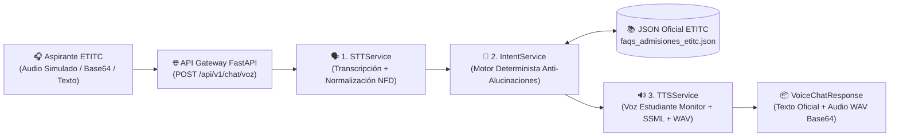

# &nbsp;🎙️ Chatbot de Voz para Admisiones ETITC — Proyecto Integrador de Ingeniería

Prototipo arquitectónico en **Python \+ FastAPI** diseñado para el **Departamento de Admisiones, Registro y Control Académico de la Escuela Tecnológica Instituto Técnico Central (ETITC)**.

El sistema implementa un **pipeline de voz modular** que simula la atención cercana de un **estudiante monitor de la ETITC**, garantizando **cero alucinaciones** mediante un motor determinista acoplado exclusivamente a la base de conocimiento normativa institucional (`faqs_admisiones_etitc.json`).

---

## 🏛️ 1\. Arquitectura del Sistema y Flujo de Integración

El proyecto aplica el patrón de **Arquitectura en Capas Orientada a Servicios**, separando los contratos de datos (`models`), la lógica de negocio de voz y lenguaje (`services`), la fuente de verdad institucional (`data`) y la capa de transporte HTTP (`main.py`).



&nbsp;

### ¿Por qué este diseño evita alucinaciones al 100%?

1. **Fuente Única de Verdad (`Single Source of Truth`):** Ningún servicio genera texto libre con modelos probabilísticos abiertos. Todas las respuestas provienen literalmente del campo `respuesta_oficial` en `data/faqs_admisiones_etitc.json`.  
2. **Separación entre Contenido Normativo y Tono Estudiantil:** El servicio `TTSService` añade únicamente saludos y muletillas estudiantiles preaprobadas en el JSON, preservando intacto el cuerpo normativo (fechas, requisitos, ciclos propedéuticos, homologaciones SENA y costos).  
3. **Derivación Segura (`Fallback Institucional`):** Si la consulta del aspirante no alcanza coincidencia con las palabras clave oficiales, el sistema activa `FALLBACK_INSTITUCIONAL` y remite a los canales oficiales (`admisiones@itc.edu.co` y PBX en la Calle 13 \# 16-74).

---

## 📂 2\. Estructura del Repositorio (Dos Versiones en el Workspace)

El espacio de trabajo contiene **dos implementaciones paralelas** con idéntica estructura modular:

```
etitc-voice-admissions-bot/
├── README.md                          # Documentación arquitectónica y guía Git
├── requirements.txt                   # Dependencias del proyecto (FastAPI, Pydantic, Pytest)
├── version_referencia/                # ✅ VERSIÓN 100% FUNCIONAL (Referencia Docente)
│   ├── main.py                        # API FastAPI completamente integrada
│   ├── models/
│   │   └── schemas.py                 # Contratos de datos Pydantic completos
│   ├── services/
│   │   ├── stt_service.py             # Transcripción de audio simulado/Base64 y normalización
│   │   ├── intent_service.py          # Clasificador determinista sobre FAQs ETITC
│   │   └── tts_service.py             # Síntesis vocal de estudiante monitor (SSML + RIFF WAV)
│   ├── data/
│   │   └── faqs_admisiones_etitc.json # Base de conocimiento oficial de Admisiones ETITC
│   └── tests/
│       └── test_integration.py        # Suite de pruebas E2E (100% en verde)
│
└── plantilla_estudiantes/             # 🛠️ VERSIÓN PLANTILLA PARA ESTUDIANTES (# TODOs)
    ├── main.py                        # Contiene # TODO: [Estudiante 1] y [Estudiante 5]
    ├── models/
    │   └── schemas.py                 # Contiene # TODO: [Estudiante 1]
    ├── services/
    │   ├── stt_service.py             # Contiene # TODO: [Estudiante 2]
    │   ├── intent_service.py          # Contiene # TODO: [Estudiante 3]
    │   └── tts_service.py             # Contiene # TODO: [Estudiante 4]
    ├── data/
    │   └── faqs_admisiones_etitc.json # Base de conocimiento oficial de Admisiones ETITC
    └── tests/
        └── test_integration.py        # Contiene # TODO: [Estudiante 6]
```

---

## 🧩 3\. Distribución de Tareas (`# TODO`) e Integración de Piezas

En la carpeta `plantilla_estudiantes/`, el código está dividido en **6 bloques lógicos independientes** para que un equipo de hasta 6 estudiantes trabaje en paralelo sin bloquearse:

| Bloque | Responsable | Archivo(s) | Responsabilidad Técnica y Contrato de Integración |
| :---- | :---- | :---- | :---- |
| **1** | `# TODO: [Estudiante 1]` | `models/schemas.py`<br>`main.py` (`/health`) | Definir el esquema de salida `VoiceChatResponse` y construir la ruta de diagnóstico `/health` leyendo metadatos del JSON institucional. |
| **2** | `# TODO: [Estudiante 2]` | `services/stt_service.py` | Implementar `normalizar_texto()` (eliminación de tildes con Unicode NFD y signos) y `transcribir()` soportando `audio_id_simulado`, `audio_base64` y `texto_directo`. |
| **3** | `# TODO: [Estudiante 3]` | `services/intent_service.py` | Implementar `resolver_intencion()` comparando tokens y frases clave contra el JSON oficial y activando `FALLBACK_INSTITUCIONAL` cuando no haya coincidencias. |
| **4** | `# TODO: [Estudiante 4]` | `services/tts_service.py` | Implementar `sintetizar_respuesta_estudiante()` ensamblando el saludo/muletillas del estudiante monitor con la respuesta oficial intacta, generando SSML y audio WAV en Base64. |
| **5** | `# TODO: [Estudiante 5]` | `main.py` (`/api/v1/chat/voz`) | Orquestar secuencialmente `STTService -> IntentService -> TTSService` en el endpoint POST principal y transformar errores de validación (`ValueError`) en `HTTP 400`. |
| **6** | `# TODO: [Estudiante 6]` | `tests/test_integration.py` | Programar las 4 pruebas de integración automatizadas con `TestClient` validando el flujo nominal, la cabecera binaria `RIFF` del audio WAV y el bloqueo anti-alucinaciones. |

### Orden recomendado de integración

1. **Contratos listos desde el día 1:** Las clases `AudioConsultationRequest`, `STTResult`, `IntentMatchResult` y `TTSOutput` ya tienen sus firmas definidas en `schemas.py`, por lo que los **Estudiantes 1, 2, 3 y 4** pueden programar sus módulos simultáneamente.  
2. **Ensamblaje del Pipeline:** Una vez que los servicios cumplen su firma de entrada/salida, el **Estudiante 5** conecta el flujo en `main.py`.  
3. **Certificación de Calidad (QA):** El **Estudiante 6** ejecuta `pytest` para certificar que todas las piezas cumplen los requisitos funcionales y no funcionales.

---

## 🚀 4\. Cómo Ejecutar y Probar el Proyecto

### Paso 1: Crear el entorno virtual e instalar dependencias

Desde la raíz del proyecto (`etitc-voice-admissions-bot/`):

```sh
python3 -m venv .venv
.venv/bin/pip install -r requirements.txt
```

### Paso 2: Ejecutar la Versión de Referencia (100% Funcional)

```sh
# Ejecutar la suite de pruebas de integración
.venv/bin/pytest version_referencia/tests/test_integration.py -v

# Levantar el servidor de desarrollo FastAPI
.venv/bin/uvicorn main:app --app-dir version_referencia --reload --port 8000
```

Una vez iniciado el servidor, abre en el navegador la documentación interactiva **Swagger UI**:

- **Swagger UI:** `http://127.0.0.1:8000/docs`  
- **Catálogo de Intenciones ETITC:** `http://127.0.0.1:8000/api/v1/admisiones/catalogo`  
- **Audios Simulados de Laboratorio:** `http://127.0.0.1:8000/api/v1/admisiones/audios-simulados`

### Ejemplo de petición `POST /api/v1/chat/voz`

```json
{
  "session_id": "aspirante-sistemas-2026",
  "audio_id_simulado": "audio_carreras_01",
  "incluir_saludo_inicial": true
}
```

---

## 🌿 5\. Guía Rápida de Control de Versiones en Git para Estudiantes

Para evitar sobrescribir el código de sus compañeros durante el proyecto integrador, sigan este flujo de trabajo basado en **Feature Branches**:

### 1\. Clonar el repositorio y ubicarse en la rama de desarrollo

```sh
git clone <URL_DEL_REPOSITORIO_DEL_EQUIPO>
cd etitc-voice-admissions-bot
git checkout -b develop
```

### 2\. Crear una rama individual por cada bloque `# TODO`

Cada estudiante **debe crear su propia rama** antes de modificar cualquier archivo en `plantilla_estudiantes/`:

```sh
# Ejemplo para el Estudiante 2 (Servicio STT):
git checkout -b feature/estudiante-2-servicio-stt

# Ejemplo para el Estudiante 3 (Motor de Intenciones):
git checkout -b feature/estudiante-3-motor-intenciones
```

### 3\. Guardar cambios con Commits Semánticos

Verifica qué archivos modificaste (`git status`) y realiza commits descriptivos:

```sh
git add plantilla_estudiantes/services/stt_service.py
git commit -m "feat(stt): implementa normalizacion NFD y transcripcion de audios simulados [Estudiante 2]"
git push -u origin feature/estudiante-2-servicio-stt
```

### 4\. Integrar mediante Pull Request (PR) y actualizar ramas

1. Abre un **Pull Request (PR)** en GitHub/GitLab desde tu rama `feature/estudiante-X-...` hacia la rama `develop`.  
2. Solicita la revisión de al menos un compañero (especialmente del **Estudiante 5** o **Estudiante 6**).  
3. Antes de subir cambios nuevos o integrar tu rama, sincroniza siempre los avances de tu equipo:

```sh
git checkout develop
git pull origin develop
git checkout feature/estudiante-5-orquestacion-api
git merge develop
```

4. **Regla de Oro del Equipo:** Ningún Pull Request se aprueba hacia `main` si el comando `.venv/bin/pytest plantilla_estudiantes/tests/test_integration.py` reporta fallos.